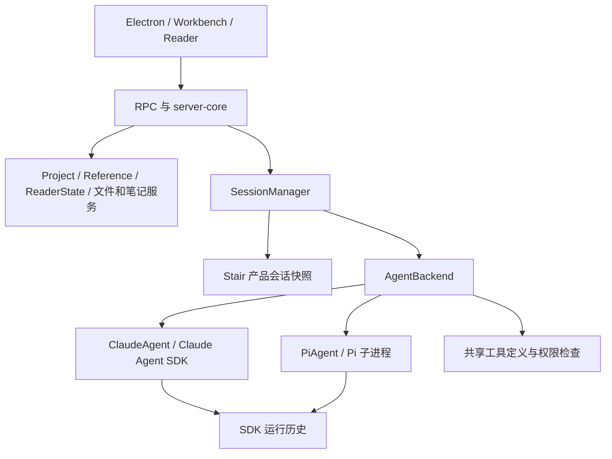
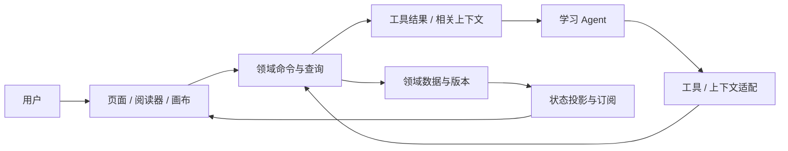

# DeepSeek Harness 与 Stair 学习 Agent 架构深度评估

评估日期：2026-11-03。Stair 基线为 `codex/stair-rebuild-v2` 分支的 `c066e656ac52bbd6bfb46995bec3990158129a15`，开始审阅时工作区干净。dsh 固定为 `deepseek-ai/deepseek-harness@ce7073d51254c26cd63b22a60835b8f948deb447`，SDK package 标识 `0.2.2-alpha.2`。研究覆盖官方文档、两边源码、三路独立审查及一次反方复核；另运行 Stair 的选定回归。没有安装 dsh 依赖、启动 dsh、调用模型或测量性能。本轮只新增此评估文档。

## 判断

**结合用户后续明确的长期目标——持续增加大量与 Agent 协作、且具有丰富独立 UI 的学习功能——应优先验证 dsh 作为完整产品插件底座，范围包括 Host 服务与 Client/UI 插件，而不只是第三种 AgentBackend。暂不直接全量迁移；是否采用整个平台，要用 Project 工作台和完整功能插件验证。**

下文前半部分保留运行时替换的源码比较；末尾“长期产品与丰富 UI 的综合判断”补充这一新前提下的目标架构、选择权衡和验证条件。

这里把“用 dsh”分成三件不同的事：借鉴架构、接入 dsh runtime、把产品整体改造成 dsh 插件。这三者的改动范围和收益不能混算。评估沿用此前来源驱动学习、Knowledge Shape 和独立输出/反馈的产品方向；这些是选型目标，不是已上线能力。

| 决策问题 | 判断 | 原因 |
|---|---|---|
| 现在整体替换 Stair 的底座和 UI？ | 不建议 | 已有 Project、Reference、Reader、Workbench 和运行契约需要重新整合，尚无收益实测 |
| 只为了接 DeepSeek 或更多模型而换？ | 不成立 | Stair 已有 Pi；dsh 的多 provider adapter 也复用 Pi AI |
| 借鉴运行日志、作用域和能力边界？ | 建议按实际问题采用 | 可以直接针对输入归属、恢复和扩展注册复杂度，不要求引入整套平台 |
| 为深度定制 tutor loop 接入 dsh？ | 值得隔离验证 | dsh 暴露 pre-step、tool pipeline、turn-stopping、projection 等明确扩展点 |
| dsh 会自动让人学得更好？ | 没有此证据 | 学习对象、Attempt、反馈证据和跨日行为仍需产品领域设计和实验 |

以上是从源码作出的选型判断；速度、token 成本、内存、稳定性和学习效果均未做对比测量。

## Stair 当前已经有什么，真正的复杂度在哪里

实际分层大致如下；第二条运行历史与第一条产品消息存储并存：



1. **桌面壳与服务已分开。** Electron 与独立 server 共用 bootstrap、SessionManager 和 RPC handlers。不能以“从 Electron 单体升级为模块化”为迁移理由。[Electron 启动](/Users/zhihu/code/m_code/ai/thinking-agent/apps/electron/src/main/index.ts:636)、[独立 Server](/Users/zhihu/code/m_code/ai/thinking-agent/packages/server/src/index.ts:168)。
2. **已有 backend 边界，但契约比 chat 函数大。** `chat()` 返回统一 AgentEvent，另有取消、soft Stop、steering、handoff、分支恢复、权限回调。工厂确实支持 Claude/Pi，不是尚未落地的接口设计。[接口](/Users/zhihu/code/m_code/ai/thinking-agent/packages/shared/src/agent/backend/types.ts:345)、[工厂](/Users/zhihu/code/m_code/ai/thinking-agent/packages/shared/src/agent/backend/factory.ts:132)。
3. **持久化不是空白，模型运行事实与产品展示记录分开。** Stair 用 header + messages JSONL 快照、500 ms 合并写及原子替换；关键路径另做 flush。Pi 还有 `.pi-sessions` journal 和 SDK session identity。这是双层所有权问题，不是“没有事件数据”。[持久化队列](/Users/zhihu/code/m_code/ai/thinking-agent/packages/shared/src/sessions/persistence-queue.ts:51)、[Pi session](/Users/zhihu/code/m_code/ai/thinking-agent/packages/pi-agent-server/src/index.ts:684)。
4. **最有根据的运行时债务是跨层输入接收与恢复。** Host 等 `input_accepted` 后退役待交付输入/审批，还要过滤旧 generation、处理 steer。source 激活受 SDK 工具刷新时点限制，会触发终止和重发原输入。dsh 统一 inbox/log/loop 能针对这类问题提供更一致的设计，但接入适配器本身不会把债务消掉。[事件处理](/Users/zhihu/code/m_code/ai/thinking-agent/packages/server-core/src/sessions/SessionManager.ts:9142)、[source activation](/Users/zhihu/code/m_code/ai/thinking-agent/packages/shared/src/agent/base-agent.ts:214)。
5. **工具、权限与任务编排已有共享实现。** canonical tool definitions、共享 pre-tool 检查、子会话 Project/权限继承都可保留；TaskRunner 已有持久 run-log、依赖 DAG、并发与重启恢复。不能将这些全算作 dsh 新增收益。[工具注册](/Users/zhihu/code/m_code/ai/thinking-agent/packages/session-tools-core/src/tool-defs.ts:844)、[子会话](/Users/zhihu/code/m_code/ai/thinking-agent/packages/server-core/src/sessions/SessionManager.ts:5697)、[TaskRunner](/Users/zhihu/code/m_code/ai/thinking-agent/packages/server-core/src/tasks/TaskRunner.ts:278)。

## 对学习产品，哪些东西不能随 harness 一起被替换

| 领域能力 | 当前源码事实 | 对选型的影响 |
|---|---|---|
| Project | 独立稳定 ID、目录和共享上下文 | 不等同于一次 Agent session 或一个 panel |
| Reference | 文件/聊天/网页统一协议；文件有 fingerprint、quote 和 locator；发送时校验来源 | 要保留结构化身份与失效语义，不能降为一个路径或一段 prompt |
| ReaderState | PDF/EPUB 进度、高亮、位置、revision 持久化 | 是阅读状态，不能当学习掌握证据 |
| 文件与笔记 | 指纹冲突检查、原子写、部分操作 requestId 幂等 | 领域服务继续拥有写入和鉴权，不把可靠性寄托于模型直接操作文件 |
| Workbench | panel 引用 Session/ProjectFile，布局归 Project | dsh Chat UI 不是等价替代 |
| Knowledge Shape | 已有文本/图等表示工具；未发现统一知识对象及表示间证据关系的生产契约 | 每种视图变成 plugin 也不会自动共享同一知识对象 |
| Attempt/反馈/修复 | 查到的 learning-loop 页面明确为 throwaway prototype；反馈固定、修复靠字符串条件 | 换运行时不等于落地学习证据系统 |

主要依据：[Reference 定义](/Users/zhihu/code/m_code/ai/thinking-agent/packages/core/src/types/reference.ts:71)、[文件来源校验](/Users/zhihu/code/m_code/ai/thinking-agent/packages/server-core/src/sessions/message-references.ts:95)、[ReaderState](/Users/zhihu/code/m_code/ai/thinking-agent/packages/shared/src/project-files/types.ts:151)、[文件更新](/Users/zhihu/code/m_code/ai/thinking-agent/packages/server-core/src/handlers/rpc/project-files.ts:827)、[笔记幂等](/Users/zhihu/code/m_code/ai/thinking-agent/packages/server-core/src/handlers/rpc/project-notes.ts:544)、[Workbench](/Users/zhihu/code/m_code/ai/thinking-agent/apps/electron/src/renderer/workbench/workbench-state.ts:9)。

两个直接反例值得注意：Drawnix 的导出树目前是 `id/topic/children`，不是包含 concept/source/evidence 关联的知识对象；学习原型提交后显示固定反馈，修复条件是包含“使用判断”。因此当前最清晰的学习产品缺口在领域语义，而非缺少通用 tool loop。[Drawnix](/Users/zhihu/code/m_code/ai/thinking-agent/apps/electron/src/renderer/components/project-files/drawnix-document-controller.ts:98)、[原型说明](/Users/zhihu/code/m_code/ai/thinking-agent/apps/electron/src/renderer/prototypes/learning-loop/main.tsx:1)、[反馈与修复](/Users/zhihu/code/m_code/ai/thinking-agent/apps/electron/src/renderer/prototypes/learning-loop/main.tsx:1029)。

这里的“未发现”限定在本轮生产源码检索范围，不代表用户外部安装的学习技能没有相应流程。Reference 校验也只是来源范围/版本等检查，不保证模型论断正确。完整的来源证据关联仍需领域层维护。

## dsh 真正值得借鉴的部分

**统一运行事实与可重建投影。** `Session.deriveMessages()` 从日志的 message surface 生成模型历史，压缩和消息投影改变模型可见视图而保留原始事件。对“当时读了哪份资料、模型实际看到了什么、工具产生了什么结果”的排查，这比只看 UI transcript 更有潜力。它不是学习者掌握程度的事实源，也不意味着任意外部副作用可以 exactly-once 重放。[实现](https://github.com/deepseek-ai/deepseek-harness/blob/ce7073d51254c26cd63b22a60835b8f948deb447/packages/core/session/src/index.ts#L981-L1029)。

**明确的持久化检查点。** checkpoint 插件在模型派发与顶层工具执行前 flush，失败时不继续调用下游。必须区分 log append 与真正持久化；服务契约明确只有 flush 是 durability barrier，最终未刷入事件或未结算的实时流仍可能在强制退出时丢失。不能把 append-only 简化成“永不丢数据”。[检查点实现](https://github.com/deepseek-ai/deepseek-harness/blob/ce7073d51254c26cd63b22a60835b8f948deb447/packages/session/session-checkpoint-policy/src/index.ts#L20-L82)、[持久化契约](https://github.com/deepseek-ai/deepseek-harness/blob/ce7073d51254c26cd63b22a60835b8f948deb447/packages/session/session-persistence/src/index.ts#L124-L142)。

**围绕稳定边界扩展。** pre-step、工具前后、turn-stopping 等扩展点可以承接资料上下文注入、不同 tutor 的工具集、结果校验和诊断；Cordis 负责注册与卸载。这比针对每个 SDK 增加特殊重试分支更有吸引力。不过只有频繁需要这些差异时，插件生命周期、依赖注入、配置叠加的学习与维护成本才更可能被摊薄。[loop pre-step](https://github.com/deepseek-ai/deepseek-harness/blob/ce7073d51254c26cd63b22a60835b8f948deb447/packages/core/agent-loop/src/agent.ts#L285-L310)、[turn-stopping](https://github.com/deepseek-ai/deepseek-harness/blob/ce7073d51254c26cd63b22a60835b8f948deb447/packages/core/agent/src/runtime-types.ts#L400-L414)。

**工具策略与业务能力分开。** 共享 pipeline 先运行可扩展 pre-execute/approval，再检查继承的 guards，然后执行工具。可以保留 Stair 的确定性拒绝与项目授权，而不是交给模型决定。Cordis 的作用域不构成恶意插件的安全隔离。[pipeline](https://github.com/deepseek-ai/deepseek-harness/blob/ce7073d51254c26cd63b22a60835b8f948deb447/packages/core/tools/src/pipeline.ts#L190-L229)、[guards](https://github.com/deepseek-ai/deepseek-harness/blob/ce7073d51254c26cd63b22a60835b8f948deb447/packages/core/tools/src/index.ts#L379-L400)。

## dsh 接入面的 12 条源码发现

### 1. 官方 SDK 是托管子进程，不是把一个 Agent 类直接嵌进主进程

`resolveDshLaunch()` 用 `process.execPath` 启动 `dsh --profile sdk`；`HarnessClient.start()` 调用 child_process.spawn、用 stdio 管 JSON-RPC。正常安装解析同版本 CLI，版本不匹配会直接报错。应用启动走 profile/patch，官方架构明确不把任意 inline Cordis tree 视为支持的应用启动路径。因此可“嵌入产品”，但推荐边界是外部 runtime 进程。已有 Pi 子进程设计可能降低这个成本；不能说子进程本身是 dsh 特有的负担。

证据：[launch.ts:55-65,128-156](https://github.com/deepseek-ai/deepseek-harness/blob/ce7073d51254c26cd63b22a60835b8f948deb447/packages/sdk/client/src/launch.ts#L128-L156)、[client.ts:219-227](https://github.com/deepseek-ai/deepseek-harness/blob/ce7073d51254c26cd63b22a60835b8f948deb447/packages/sdk/client/src/client.ts#L219-L227)、[architecture:41-47](https://github.com/deepseek-ai/deepseek-harness/blob/ce7073d51254c26cd63b22a60835b8f948deb447/docs/architecture.md#L41-L47)。

### 2. `sdk-minimal` 不是随意挑几个 core 包的空白 SDK，且默认策略不适合直接沿用

它是一份完整的预制应用树，直接配置 DeepSeek API adapter、持久 shell、read_image、working_directory、compaction 和 JSONL；sandbox-policy 默认 `danger-full-access`。它省掉 full sdk 的 credentials/settings/skills/subagents 等产品能力，添加这些能力需要显式 patch。注意 README 的“omits jobs”指用户可见 jobs 能力：源码仍包含 `jobs-local` 服务，不能写成完全没有 jobs 基础设施。

证据：[sdk-minimal/cordis.patch.yml:26-31,70-74,95-142,172-179](https://github.com/deepseek-ai/deepseek-harness/blob/ce7073d51254c26cd63b22a60835b8f948deb447/packages/bundle/sdk-minimal/cordis.patch.yml#L26-L74)、[minimal README](https://github.com/deepseek-ai/deepseek-harness/blob/ce7073d51254c26cd63b22a60835b8f948deb447/packages/bundle/sdk-minimal/README.md)。

### 3. SDK 的事件通知不等于逐 token 流式输出——这是当前接入的硬差异

server 订阅 `session/event` 和 `agent/status` 并转发到 SDK；协议 NotificationMap 没有 `agent/assistant-stream` frame。dsh 运行时把模型完整 attempt 流在完成时嵌到 durable assistant/message/attempt 中，真正实时 token 走另一个进程内事件；Web 的 session-controller 另有 bridge。因此只连现成 SDK `onNotification`，无法据此承诺保留 Stair 的实时 token UI。需要补 bridge 或走已有 Web/API 事件通道；不是 dsh loop 无法流式。

证据：[SDK server:171-186](https://github.com/deepseek-ai/deepseek-harness/blob/ce7073d51254c26cd63b22a60835b8f948deb447/packages/sdk/server/src/server.ts#L171-L186)、[protocol:191-207](https://github.com/deepseek-ai/deepseek-harness/blob/ce7073d51254c26cd63b22a60835b8f948deb447/packages/sdk/protocol/src/types.ts#L191-L207)、[live bridge implementation](https://github.com/deepseek-ai/deepseek-harness/blob/ce7073d51254c26cd63b22a60835b8f948deb447/packages/api/session-controller/src/history/assistant-stream.ts#L17)。

### 4. SDK 没有通用单 Session abort RPC；请求超时不取消 runtime 工作

协议和 server switch 均只有 initialize/prompt/query/resume/wait/working-directory/shutdown。client 明确把 timeout 视为放弃等待，不是终止后台任务。close 会关闭整个 runtime，不能拿它等价替代多会话产品的“停止当前回答”。loop 层具备 cancellation，这里缺的是 SDK transport 暴露方式。若扩展 bridge，需要验证停止模型、并行工具、审批等待、子 agent 与恢复是否都保持一致。

证据：[protocol requests:210-218](https://github.com/deepseek-ai/deepseek-harness/blob/ce7073d51254c26cd63b22a60835b8f948deb447/packages/sdk/protocol/src/types.ts#L210-L218)、[server switch:498-539](https://github.com/deepseek-ai/deepseek-harness/blob/ce7073d51254c26cd63b22a60835b8f948deb447/packages/sdk/server/src/server.ts#L498-L539)、[client timeout contract:181-188](https://github.com/deepseek-ai/deepseek-harness/blob/ce7073d51254c26cd63b22a60835b8f948deb447/packages/sdk/client/src/client.ts#L181-L188)。

### 5. `run()` 的 finalResponse 是活动区间最后回答，不是严格“一次输入对应一次答案”

run 订阅 session tree、提交 input、等待 message 收据，然后直到 root agent idle。中间 steering/injected context/其他 queued input 可以共同参与；现有 run API 不为每条 prompt 分配唯一结果因果链。学习评测若把 finalResponse 直接绑定某次答题 Attempt，会有语义错误风险。必须通过明确 domain IDs/事件去记录测验提交和评价，不应从聊天最后一句倒推学习结果。

证据：[api.ts:260-299](https://github.com/deepseek-ai/deepseek-harness/blob/ce7073d51254c26cd63b22a60835b8f948deb447/packages/sdk/client/src/api.ts#L260-L299)、[SDK README:79,98,145](https://github.com/deepseek-ai/deepseek-harness/blob/ce7073d51254c26cd63b22a60835b8f948deb447/packages/sdk/client/README.md#L79)。

### 6. 能与宿主 UI 对接问题和审批，但不能照搬现有业务 callback 注册方式

SDK 有 onUserQuestion，approvalRequests 可把一次操作审批交给 client.onRequest，错误 fail closed。协议却没有通用工具注册/回调 RPC，宿主学习工具需要注册成 dsh 插件或通过 MCP/自建桥接来调用现有领域服务。最小可行路径是只把模型驱动放到 dsh，Project/Source/Attempt 的鉴权与数据仍由宿主掌握；不是把所有工具逻辑重写到 dsh。

证据：[types.ts:24-26,58-70](https://github.com/deepseek-ai/deepseek-harness/blob/ce7073d51254c26cd63b22a60835b8f948deb447/packages/sdk/client/src/types.ts#L24-L70)、[server approval:130-147](https://github.com/deepseek-ai/deepseek-harness/blob/ce7073d51254c26cd63b22a60835b8f948deb447/packages/sdk/server/src/server.ts#L130-L147)、[protocol request surface](https://github.com/deepseek-ai/deepseek-harness/blob/ce7073d51254c26cd63b22a60835b8f948deb447/packages/sdk/protocol/src/types.ts#L210-L241)。

### 7. dsh 不锁 DeepSeek；很多多模型能力本身来自 Pi AI

llm-pi-ai 用配置 route 注册 adapter，复用 pi-ai 的 catalog providers/native auth；自定义 route 支持 openai-completions/openai-responses/anthropic-messages。catalog routes 可保留 Bedrock 等更特殊 provider 的实现。当前依赖 `@earendil-works/pi-ai ^1.3.0`。因此“迁移 dsh 获得多模型”不能单独成立：Stair 已有 Pi，应比较 dsh 提供的统一 runtime/事件与策略，而非重复计算模型 API 的收益。LLM adapter 支持 Claude 模型也不等于保留 Claude Agent SDK 的全部工具、会话、认证和执行语义。

证据：[provider.ts:22-51,144-157](https://github.com/deepseek-ai/deepseek-harness/blob/ce7073d51254c26cd63b22a60835b8f948deb447/packages/llm/llm-pi-ai/src/provider.ts#L22-L51)、[index.ts:311-333](https://github.com/deepseek-ai/deepseek-harness/blob/ce7073d51254c26cd63b22a60835b8f948deb447/packages/llm/llm-pi-ai/src/index.ts#L311-L333)、[dependency](https://github.com/deepseek-ai/deepseek-harness/blob/ce7073d51254c26cd63b22a60835b8f948deb447/packages/llm/llm-pi-ai/package.json)。

### 8. Cordis 的收益不是“文件拆得多”，而是 registrations 可跟随作用域和卸载

createScope 创建拥有独立注册生命周期的 fiber，dispose 等待异步 teardown 完成；事件按 scope 链向祖先路由，registrations 可按 scope 继承。适合不同 tutor/reviewer/source worker 的能力与生命周期组合，减少在大 SessionManager 里堆判断。但它是逻辑注册与事件隔离，不是操作系统安全隔离；全局未带 tag 的 listener 仍能看到所有 scoped 事件。学习者/Project 权限不能只靠 Cordis scope。

证据：[scope/index.ts:104-145](https://github.com/deepseek-ai/deepseek-harness/blob/ce7073d51254c26cd63b22a60835b8f948deb447/packages/core/scope/src/index.ts#L104-L145)、[scope/index.ts:158-180](https://github.com/deepseek-ai/deepseek-harness/blob/ce7073d51254c26cd63b22a60835b8f948deb447/packages/core/scope/src/index.ts#L158-L180)。

### 9. 它有 Electron 产品，但这不代表可直接替换 Stair 的 Electron 层

其 Desktop 是完整 dsh Web app 的宿主。源码启动独立 desktop-host 子进程；Web 负责业务 RPC 与 streams，Node IPC 主要管 boot/readiness/shutdown。打包把 shell 与 dsh exact version 绑成同一个签名发布单元，还要带 Node/pnpm/native 依赖。现有 Stair 更现实的选择是保留自身 UI/协议、只打包匹配 dsh runtime，而非复制 dsh Desktop。初始进程数/包大小/冷启动成本需测量，不能从源码猜性能一定更好或更差。

证据：[host-process.ts:209-224](https://github.com/deepseek-ai/deepseek-harness/blob/ce7073d51254c26cd63b22a60835b8f948deb447/apps/desktop/src/host-process.ts#L209-L224)、[Desktop README:116-124](https://github.com/deepseek-ai/deepseek-harness/blob/ce7073d51254c26cd63b22a60835b8f948deb447/apps/desktop/README.md#L116-L124)。

### 10. 模型历史 replay/resume 是明确能力，但不恢复外部进程或业务学习状态

resumeSession 会从指定 home 恢复持久化 session，修复中断 turn，不自动重新输入；找不到/不兼容/被占用会报错，shell/browser 不恢复。对于学习 agent，“上次回答与上下文恢复”有帮助，但来源版本、学习对象、Attempt 与多形态视图不是自动产生的。它们必须有自己的领域数据/事件关系，跨 session 的学习状态尤其不能依赖某一个 chat log。

证据：[SDK README:56](https://github.com/deepseek-ai/deepseek-harness/blob/ce7073d51254c26cd63b22a60835b8f948deb447/packages/sdk/client/README.md#L56)、[architecture log/projection:124-130](https://github.com/deepseek-ai/deepseek-harness/blob/ce7073d51254c26cd63b22a60835b8f948deb447/docs/architecture.md#L124-L130)。

### 11. SDK 子 agent 通知目前只覆盖 in-process 子会话；不能推断所有外部代理已有统一完整 UI

subagent.finished 在 `info.local` 为 false 时直接返回；session-tree filter 依赖 parent/child session edge。dsh 的 subagent service 可以接不同 provider，但 SDK notification surface 不必然对每个 provider 达到相同完整度。若 Stair 使用 Claude/Pi 外部子 agent，必须分开验证 lifecycle、结果、取消、权限和恢复。

证据：[server.ts:188-214](https://github.com/deepseek-ai/deepseek-harness/blob/ce7073d51254c26cd63b22a60835b8f948deb447/packages/sdk/server/src/server.ts#L188-L214)。

### 12. 成熟度需依据支持承诺和实测，不能看代码体量或仓库热度

README 明确 developer preview/breaking changes；SDK 版本是 0.2.2-alpha.2，client 与 CLI exact match。源码有 SDK resume/approval/commands/shutdown 测试及 snapshot 目录，这表明维护者覆盖了这些合同，但本轮没有执行，也没有证明 Stair 的生产运行场景。正式选型应锁版本并做契约验证，再谈长期迁移。

证据：[README:11-13](https://github.com/deepseek-ai/deepseek-harness/blob/ce7073d51254c26cd63b22a60835b8f948deb447/README.md#L11-L13)、[SDK manifest:4](https://github.com/deepseek-ai/deepseek-harness/blob/ce7073d51254c26cd63b22a60835b8f948deb447/packages/sdk/client/package.json#L4)、[SDK server tests](https://github.com/deepseek-ai/deepseek-harness/tree/ce7073d51254c26cd63b22a60835b8f948deb447/packages/sdk/server/tests)。

## 反方复核：现成 SDK 的缺口，不等于 dsh 没有可复用的交互 API

官方 **Remote Gateway + Session Controller** 是必须纳入比较的另一条路线。Gateway 的 `./client` 支持 standalone Node ESM，不必把 dsh Web UI 嵌入 Stair。Session Controller 已有 `session.cancel`、带 `assistantStream` 的 `follow`，客户端已有 sequence/gap/reconnect 处理。复用它可能比自己补 token stream、取消和历史同步更省事。[Node client 入口](https://github.com/deepseek-ai/deepseek-harness/blob/ce7073d51254c26cd63b22a60835b8f948deb447/packages/api/gateway/README.md#L54-L56)、[cancel](https://github.com/deepseek-ai/deepseek-harness/blob/ce7073d51254c26cd63b22a60835b8f948deb447/packages/api/session-controller/src/index.ts#L511-L518)、[follow](https://github.com/deepseek-ai/deepseek-harness/blob/ce7073d51254c26cd63b22a60835b8f948deb447/packages/api/session-controller/src/index.ts#L599-L608)、[流客户端](https://github.com/deepseek-ai/deepseek-harness/blob/ce7073d51254c26cd63b22a60835b8f948deb447/packages/api/session-controller/src/client/transport.ts#L153-L184)。

但这些方法仍需正确 profile 组合、连接认证、权限、版本和 Electron 进程管理。Session Controller 依赖 workspace、fileUploads、remoteAccess、Typert 等服务；是否能裁成适合 Stair 的配置，本轮没有运行验证。[依赖声明](https://github.com/deepseek-ai/deepseek-harness/blob/ce7073d51254c26cd63b22a60835b8f948deb447/packages/api/session-controller/src/index.ts#L136-L150)。

还有一个不能忽略的语义差异：官方 `cancel` 调用 `agent.cancel(..., { keepInbox: true })`，会保留待处理输入。Stair 的 Stop/handoff/恢复有自己的区分。因此有同名取消按钮并不表示行为等价；需要明确停止前台、取消待交付输入、停止子任务分别由谁负责。[实现](https://github.com/deepseek-ai/deepseek-harness/blob/ce7073d51254c26cd63b22a60835b8f948deb447/packages/api/session-controller/src/commands.ts#L459-L477)。SDK 的 `session/query` 也不是已有的 Stop 后门：仅执行已注册命令，否则退回普通 prompt；本轮查到的 builtin 列表没有 stop/cancel。[query 路由](https://github.com/deepseek-ai/deepseek-harness/blob/ce7073d51254c26cd63b22a60835b8f948deb447/packages/sdk/server/src/server.ts#L297-L339)、[builtin 列表](https://github.com/deepseek-ai/deepseek-harness/blob/ce7073d51254c26cd63b22a60835b8f948deb447/packages/interaction/commands/src/builtin.ts#L4-L20)。

| 接入方式 | 可以复用 | 主要成本 | 当前建议 |
|---|---|---|---|
| 官方 SDK stdio | 启动、prompt/resume、事件、提问与一次审批 | 补实时流、单会话控制、工具回调和状态映射 | 适合后台任务候选，不能直接当完整交互替换 |
| 官方 Remote Session API | 实时流、取消、history/fork、重连和状态 API | profile 依赖、认证、权限、Stair 语义适配 | 交互式实验应优先比较 |
| 自有 bridge 插件 | 可只暴露需要的契约 | 自己维护协议、生命周期与升级兼容 | 官方 API 不满足明确要求时才考虑 |
| 整体采用 dsh 产品/插件树 | 最大程度复用其运行与产品基础设施 | 重整工作台、领域服务、数据和发布链路 | 当前不推荐 |

## 如果试验，先确定状态由谁负责

两个存储不是问题；**同一类运行事实存在两个权威写入者才是问题**。仅在工厂增加 DshAgent，同时保留双方对输入接收、队列消费、turn 结束和恢复位置的独立判断，会增加第三套适配负担，不能据此宣称架构债已解决。

| 数据/决策 | 建议的权威 | 另一侧怎么使用 |
|---|---|---|
| Project、来源身份/版本、ReaderState、笔记与文件 | Stair 领域服务 | dsh 通过受权限约束的工具调用 |
| 知识对象、多表示关联、Attempt/Feedback/Repair | 独立于 runtime 的 Stair 领域数据；本行均为待落地的领域目标 | 将必要上下文与 domain ID 提供给模型 |
| 实验会话的 inbox、模型请求、工具事实、turn、resume/fork | dsh runtime log/服务 | Stair 接收事实并生成可重建消息投影 |
| 用户命名、归档和工作台布局等产品事实 | 明确归属 Stair 的产品层 | 必要时用有版本/幂等语义的命令同步 |
| 工具是否有权读取/写入某 Project | Stair 确定性授权规则 | dsh approval/guard 可进一步收紧，不扩大权限 |

此表是建议边界，不是本轮已实现架构。具体事件仍须保留 input ID、tool call ID、domain ID 的关联；不能从“最后一条 assistant 文本”反推一次学习尝试的评价结果。

旧会话也不宜盲目转换：Stair 的工具消息经过截断、路径改写、脱敏和展示加工，不等同于原始模型上下文。保留旧后端恢复旧会话、新建隔离的 dsh 实验会话，比用 UI 消息伪造可忠实 resume 的 dsh 日志更稳妥。[产品消息加工](/Users/zhihu/code/m_code/ai/thinking-agent/packages/server-core/src/sessions/SessionManager.ts:11774)。

## 建议的验证边界与决策条件

先做一个隔离的运行时兼容实验，保留现有 UI、Project 和来源服务；无需先新建插件市场、重写全部工具或实现完整学习平台。

1. **真实来源输入：**选择 PDF/EPUB/文本中的引用，回答并回到原位置；校验 fingerprint、错误 Project 拒绝和重试时的引用保真。
2. **交互与终止：**逐 token 输出，中途追加输入，停止当前会话；审批等待/工具运行中停止，其他会话不受影响，旧输入不会意外复活。
3. **持久化与恢复：**在 receipt 前后、模型调用前、工具执行后故障注入；证明不会丢已确认输入，不会未经判断重复非幂等工具操作。
4. **工具与权限：**复用一个只读领域工具和一个受控笔记写入工具；验证拒绝、来源变更、工具错误、权限继承及结果身份。
5. **运行成本：**同模型、同来源、同 prompt/工具策略下测首 token、总时长、请求/token 数、内存、启动时间；框架与模型收益分开记录。
6. **发布与升级：**packaged Electron 能启动匹配 runtime，路径/资源/凭证正确，升级旧日志与回滚路径明确。

上述是建议验收项，尚未执行 dsh 接入。若官方 Remote API 仍需大面积改核心、无法维持关键契约，或新增维护成本超过可删除的跨层协调逻辑，就不推进迁移。若能在不削弱领域边界的前提下减少重复的 inbox/恢复协调，并在后续两三个真实扩展需求中体现更低改动成本，再扩大使用范围。

运行时兼容通过后，再验证学习收益：同一知识对象的文字/图示切换是否保留来源与问题；是否持久记录独立 Attempt、提示使用、反馈依据与修复；第二次返回能否恢复这些证据。延迟保持与迁移任务需要单独评估，不能用多 Agent 数量、生成内容数量或运行时 benchmark 替代。沿用此前 Anki 分工时，复习排程和历史继续由 Anki 负责，不因 harness 迁移另造一套。

## 本轮验证和未验证范围

根审查运行以下 4 个文件，**17 pass / 0 fail**：

```text
bun test packages/server-core/src/sessions/sendmessage-durability.test.ts \
  packages/server-core/src/sessions/message-references.test.ts \
  packages/server-core/src/sessions/input-admission.test.ts \
  packages/server-core/src/sessions/input-recovery-persistence.test.ts
```

独立审查用临时 `CRAFT_CONFIG_DIR` 运行以下 3 个文件，**外层 29 pass / 0 fail**；其中 input-delivery 包装器还执行了 6 和 12 个通过的 fixture 测试，不与外层重复汇总：

```text
bun test packages/server-core/src/sessions/input-delivery-proof.test.ts \
  packages/server-core/src/sessions/activation-continuation.test.ts \
  packages/session-tools-core/src/tool-defs-filtering.test.ts
```

合计 7 个所选测试文件的外层结果为 **46 pass / 0 fail**。测试覆盖接收确认前持久化、恢复、来源引用、source 激活续跑、输入身份、Stop/新 turn 边界和工具筛选；部分测试使用 stub，durability 测试还刻意允许 ack 后的 agent-init 失败。因此这些结果证明的是选定合同，不能当作完整真实 Agent 成功运行。

未执行：dsh 测试/安装/启动、真实模型调用、dsh 与 Stair 的端到端接入、全仓 validate:ci、Electron 打包/native E2E、性能 A/B、长期稳定性或学习效果实验。没有据此给出速度、费用、稳定性或学习效果上的优胜结论。

上述运行时结论仍适用于“只替换 AgentBackend”的方案。用户补充长期功能平台和丰富 UI 目标后，选型范围应扩大，综合建议如下。

## 长期产品与丰富 UI 的综合判断

**推荐的目标方向是：dsh 的运行与插件装配机制 + Stair 的学习领域基础 + 适合学习的工作台。优先验证这一完整方案，不能只接上 dsh 后端，就声称获得了它的全栈插件能力。** 这是一项架构推荐，尚未通过集成、性能或维护成本实测。

### UI 支持是真实能力，已经超出聊天卡片

dsh 客户端是独立的 Cordis 应用。Host 拥有业务状态、存储、权限和变更顺序；Remote 连接到 React-free Client models；UI adapter 和 Slots 将状态提供给 React 组件。用户点击通过 callback 调用领域 command/Remote，不必进入模型 turn。[官方客户端分层](https://github.com/deepseek-ai/deepseek-harness/blob/ce7073d51254c26cd63b22a60835b8f948deb447/docs/subsystems/web-client.md#L9-L38)。

可扩展的界面包括独立主页面、侧栏 tab、浮动/分屏面板、全局 overlay、设置与对话组件。`main` 是 root 级 keyed slot，`conversation` 只是其中的保留 key；其他主页面不自动绑定 Session。Renderer 接受普通 React 业务组件，并统一提供响应式状态绑定。[主页面契约](https://github.com/deepseek-ai/deepseek-harness/blob/ce7073d51254c26cd63b22a60835b8f948deb447/packages/client/ui-layout/src/client/index.ts#L54-L107)、[Renderer](https://github.com/deepseek-ai/deepseek-harness/blob/ce7073d51254c26cd63b22a60835b8f948deb447/packages/client/ui-renderer/README.md#L26-L58)。

一个实际范例是 Schedule：`schedule` 管独立持久化及领域规则，`tool-schedule` 提供 Agent 工具，`ui-schedule` 提供任务管理页、侧栏详情和对话卡片。UI 编辑和 Agent 工具共同调用服务，而非各自维护一份任务真相。这是未来学习功能可以参照的完整形态。[Schedule 分层](https://github.com/deepseek-ai/deepseek-harness/blob/ce7073d51254c26cd63b22a60835b8f948deb447/packages/schedule/README.md#L12-L40)、[独立存储](https://github.com/deepseek-ai/deepseek-harness/blob/ce7073d51254c26cd63b22a60835b8f948deb447/packages/schedule/schedule/src/index.ts#L223-L303)、[UI 注册及服务调用](https://github.com/deepseek-ai/deepseek-harness/blob/ce7073d51254c26cd63b22a60835b8f948deb447/packages/client/ui-schedule/src/client/index.ts#L77-L132)。

### 功能插件应包含业务能力，UI 和 Agent 是它的两个入口

以下是建议设计，并非 dsh 已经提供的学习功能：



| 学习功能 | UI 入口 | Agent 入口 | 共享领域能力 |
|---|---|---|---|
| 资料阅读 | PDF/EPUB、选区、高亮、笔记 | 读取指定来源、解释选区、提出笔记修改 | 来源身份、版本、locator、笔记 |
| Knowledge Shape | 文本、图、表和其他视图 | 生成或建议修改某种表示 | 同一知识对象及来源关系 |
| 练习与反馈 | 作答编辑器、差异反馈、修复记录 | 生成练习、评议回答、提出后续问题 | Attempt 身份、提示使用、量规和反馈版本 |
| 学习证据页 | 筛选、比较、查看历史证据 | 解释差异、建议下一步 | 可追溯学习记录与查询 |
| Anki 导出 | 卡片预览、修改和选择导出 | 从选定来源提出卡片候选 | 稳定卡片身份、来源、导出数据；沿用 Anki 排程分工 |

业务界面可以在没有模型调用时浏览、编辑、保存。只有需要解释、生成、评议或规划时才调用 Agent；拖动画布、修改文本或选中节点不应逐次触发 LLM。UI 和 Agent 并发修改时，由同一领域服务校验版本、授权与操作身份。

领域服务本身完全可以以 Cordis 插件挂载。保留领域边界不意味着必须把它放到插件系统之外。Project、来源、存储与迁移、知识对象、权限等可作为产品固定启用的基础插件；不同视图、导入导出、练习形式、tutor 策略等按需要组合。功能很小时保持单包即可，只有职责确实独立演进时再拆服务、工具和 UI 包，最终可用 bundle 作为一个产品功能交付。

业务数据不随 UI 或 Agent 实例销毁。知识对象与学习证据可以跨 Session 存在；运行日志通过 ID 引用它们。文字与思维导图等插件必须共享知识对象和来源身份，不能各自生成一套独立“知识”。

### 默认 UI 壳与学习工作台仍有实际差异

1. **默认布局偏 Session。** 右侧工作区按 Session 管理，缺少 Session 时没有该 surface；Stair 当前工作台按 Project 保存，资料与多个 Session 可以并列。这是状态所有权和导航契约的差异，不是换皮即可解决。[dsh 右栏](https://github.com/deepseek-ai/deepseek-harness/blob/ce7073d51254c26cd63b22a60835b8f948deb447/packages/client/ui-sidebar-right/README.md#L63-L78)、[Stair 布局](/Users/zhihu/code/m_code/ai/thinking-agent/packages/shared/src/workbench-layout/index.ts:6)。
2. **默认右栏的 dock 最多两个水平 pane。** 这一上限属于现成产品实现及恢复校验，不是 React/插件平台上限。更自由的资料、练习、多对话并置需要定制 surface 或主页面内工作台。[pane 限制](https://github.com/deepseek-ai/deepseek-harness/blob/ce7073d51254c26cd63b22a60835b8f948deb447/packages/client/ui-sidebar-right/src/client/stores.ts#L349)、[恢复格式](https://github.com/deepseek-ai/deepseek-harness/blob/ce7073d51254c26cd63b22a60835b8f948deb447/packages/client/ui-sidebar-right/src/client/persistence.ts#L40-L43)。
3. **框架支持定制根 UI，但需要保留或替换完整契约。** root 是内建 single slot；占用者可替换。不过默认 layout 同时提供 root、子 slots 和 `ctx.layout`，不能只换一个 AppFrame 就假设所有内置 UI 插件仍然可用。[Slots](https://github.com/deepseek-ai/deepseek-harness/blob/ce7073d51254c26cd63b22a60835b8f948deb447/docs/subsystems/slots.md#L58-L66)、[layout 注册](https://github.com/deepseek-ai/deepseek-harness/blob/ce7073d51254c26cd63b22a60835b8f948deb447/packages/client/ui-layout/src/client/index.ts#L177-L205)。
4. **插件数量和大组件会影响启动策略。** 当前 renderer 等完整 client roster settle 后才挂载，尚无逐条 slot entry 的 lazy loading/Suspense 集成。未来引入多个重型编辑器时，需要实测启动、按需加载与内存，不能认为插件化天然带来性能优势。[已知限制](https://github.com/deepseek-ai/deepseek-harness/blob/ce7073d51254c26cd63b22a60835b8f948deb447/packages/client/ui-renderer/README.md#L87-L95)。
5. **外部插件构建仍有专用契约。** `dsh.client` + `./client` 是正式加载入口，但客户端 bundle 需特定 factory 格式，生成 preset 当前位于仓库内部。独立发布包需要复现构建流程，不能等同于发布任意 React npm 包。[构建约定](https://github.com/deepseek-ai/deepseek-harness/blob/ce7073d51254c26cd63b22a60835b8f948deb447/docs/cookbook/adding-a-settings-card.md#L56-L72)。

持久化也需准确区分：默认 layout 的部分几何/导航重载重置，而右栏会以 Session 为单位保存到 localStorage；不是全部 UI 状态都不持久化，也不是现成的跨设备领域存储。

### 综合方案选择与优先验证

| 路线 | 长期收益 | 主要代价 | 判断 |
|---|---|---|---|
| 继续 Stair，在现有模块内扩展 | 保留全部既有交互，初期最直接 | 后续若需要统一功能插件，还需建设宿主和前端扩展契约 | 仍是合理基线，不能只凭插件口号否定 |
| Stair UI + dsh 运行时 | 复用现有 UI，获得运行时组合能力 | 不自动获得 dsh 客户端插件机制 | 可作过渡或 runtime 方案，不代表完整目标已实现 |
| dsh Host/Client 插件宿主 + 学习领域基础 + 定制工作台 | UI、领域服务、Agent 能力和生命周期用一致机制装配 | 工作台/状态适配、构建与版本管理，部分 UI 契约迁移 | **当前长期目标下优先验证** |

先按第一方功能插件构建，不需要预先做插件市场或任意第三方代码的隔离平台；同进程插件的逻辑作用域不应被误认为安全隔离。安装功能也不意味着把所有工具和提示常驻每次模型请求，应按权限、当前对象和学习阶段提供所需能力。

最有决策价值的样板是一个带丰富 UI 的完整学习功能：**在 Project 工作台中同时打开资料阅读器、知识对象编辑页和学习对话；用户与 Agent 都能通过同一服务更新来源关联或提出表示修改，其他视图同步反映结果。** 此样板不要求先完成所有学习产品。

验证要回答：无 active Session 或模型不可用时 UI 是否仍可用；用户与 Agent 并发编辑是否有版本检查；切 Project/Session 是否保持资料归属、选区、草稿和引用目标；插件关闭/升级、进程重启后哪些状态恢复；新增第二个视图或工具是否只需要增加插件，而不用修改 agent loop 和散布业务判断；自定义工作台实际保留了多少 dsh 现有能力。

若这些检查成立，应采用并逐步迁入新的学习功能。若主要工作变成持续绕开 dsh 的 Session 假设、替换大量客户端基础服务，则保留 Stair 工作台、仅使用 dsh runtime 的路线可能更合算。**长期架构方向可以现在决定，整个平台迁移应由完整功能样板的证据决定。** 本补充仍为源码评估和建议，未实施该样板。
