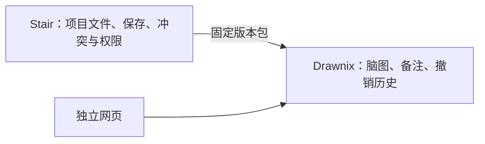

# Drawnix 节点备注与独立包接入

节点备注的界面、数据操作和撤销历史放在 Drawnix fork 内；Stair 通过独立包接入，继续负责项目文件保存、冲突检测和 Agent 权限。

## 代码与版本

- Fork：[TTsWorld/drawnix，codex/node-notes](https://github.com/TTsWorld/drawnix/tree/codex/node-notes)
- 基线：上游 `v0.4.0-2`，`1d614bb60fc99132e0cd55a608a14fe786f4ee9b`，与此前 Stair 使用的版本对应。
- 初始实现提交：`e451710`；行为保持的整理提交：`58b3059`；备注交互修复提交：`60aa1bd`；布局时序修复：`5721b22`，外部文件加载回归测试：`2a5ef3e`；并发输入节点定位修复：`8db4bfc`；发布文件完整性修复：`f1ba893`。
- 当前包：`@ttsworld/drawnix@0.4.0-notes.6`，从 [GitHub Release](https://github.com/TTsWorld/drawnix/releases/tag/v0.4.0-notes.6) 下载固定版本归档；未发布到 npm registry。
- Stair 的 `apps/electron/package.json` 与 `bun.lock` 固定该归档 URL，不依赖相邻源码目录、临时路径或 `npm link`。
- 当前归档 SHA-256：`52d4266c1d5014825596b94e416a27fde8c3cd0e3907219a3ee7e3a2fd87f42a`。已重新下载 Release 文件并核对一致。

## 使用与数据

选中脑图节点，点击浮动工具栏的“添加备注”。右侧面板支持多行纯文本，节点继续展示简短标题。有内容时，节点旁显示备注图标，点击即可重新打开。支持删除、撤销和重做。

备注保存在节点顶层可选的 `note: string` 字段中，随 `.drawnix` 文件保存和导入导出；空备注会移除该字段。旧文件不需要迁移。字段放在 `data` 之外，是因为 Plait 的删除 emoji 操作会重建 `data`。

本次采用纯文本备注，没有增加富文本编辑器或独立笔记库。上游 Drawnix 不展示该扩展字段；使用其他版本编辑后，需核对其是否保留备注。

## 模块边界



`Drawnix` 通过 `onEditorReady` 提供三个方法：

- `serialize()`：序列化当前文档。
- `readMindmap()`：返回节点 ID、标题、备注和子节点。
- `updateMindmap(operations)`：执行带撤销历史的原子操作批次。

Stair 的 `DrawnixDocumentController` 不再直接操作 Plait；保留保存调度、文件指纹和 `changeSeq` 并发保护。Agent 的 `mindmap_read` 返回可选 `note`，`mindmap_update` 支持 `set_note`，仍需之前读取的 `expectedChangeSeq`。包中没有 Stair、Electron 或项目会话依赖。

## 独立启动

```sh
cd /Users/zhihu/code/m_code/ai/drawnix
npm ci
npm run dev:notes -- --host 127.0.0.1
```

独立包的接口和打包说明见 fork 的 [NOTES.md](https://github.com/TTsWorld/drawnix/blob/codex/node-notes/NOTES.md)。

## 首次功能验收（0.4.0-notes.1）

| 检查 | 结果 |
| --- | --- |
| Fork 文档与历史测试 | 6 项通过；覆盖备注往返、旧文件、改名/删除 emoji、删除与撤销重做、失败批次回滚 |
| Fork 类型检查、包构建、独立网页构建 | 通过 |
| 空目录安装 Release 包，React 18 类型检查与 Vite 构建 | 通过；不使用 Stair 或 fork 的 node_modules |
| 独立浏览器操作 | 新增多行中文备注、关闭/重开、删除、撤销/重做及快捷键、复制节点、刷新、导出/重新导入通过 |
| Stair 相关测试 | 64 项通过，覆盖控制器保存/并发、创建、注册、项目隔离、Agent schema/工具筛选与 Chromium 文本布局 |
| Electron、WebUI、server-core、session-tools-core 类型检查 | 通过 |
| Electron renderer、WebUI 生产构建 | 通过 |
| 固定锁文件安装、两个仓库 diff 检查 | 通过 |
| 实际 Electron DEV | 输入多行备注后检查文件落盘；完整重启进程，重新打开文件和备注图标，内容一致 |

桌面验证使用 `/tmp/stair-drawnix-notes-qa` 独立配置、端口 7293 和独立应用身份。未替换已安装的正式版 Stair，也未执行 Stair 全仓 `validate:ci` 或正式安装包验收。工作区中其他并行任务的改动已保留；本次未提交或推送 Stair 工作区。

## 代码整理验证（0.4.0-notes.2）

共用增量操作中的节点定位，明确备注图标的坐标转换，复用按钮文案，并清理未使用的导入、测试中的旧接口别名和重复类型断言。没有新增依赖或扩展接口。

- 整理前：6 项包测试、19 项直接相关的 Stair 测试通过。
- 整理后：6 项包测试通过；安装新归档后，44 项 Stair 相关回归通过。
- Drawnix、Electron、session-tools-core 类型检查及独立包构建通过。
- 新旧归档的 99 个类型声明和 CSS 文件逐字节一致，包导出和依赖声明一致（仅版本号变化）。
- 固定锁文件安装、归档下载 SHA-256 核对、两个仓库 diff 检查通过。

本轮验证限定在等价重构涉及的代码和包接入路径，未重复全仓 CI、完整 WebUI/桌面构建或桌面端到端验收；上面的桌面记录对应首次功能版本。`0.4.0-notes.1` 的已发布归档保留。

重跑相关自动检查：

```sh
# Drawnix fork
npm run test:notes
npm run typecheck:notes
npm run build:package

# Stair 根目录
bun install --frozen-lockfile
bun test apps/electron/src/renderer/components/project-files/__tests__/drawnix*.test.ts apps/electron/src/renderer/pages/__tests__/project-file-drawnix.test.ts packages/server-core/src/sessions/drawnix-project-scope.test.ts packages/session-tools-core/src/handlers/mindmap.test.ts packages/session-tools-core/src/tool-defs-filtering.test.ts
```

## 审查修复（0.4.0-notes.3）

- 备注面板隔离复制、剪切和粘贴事件，保留输入框的原生文本编辑，避免触发画布复制/删除节点。
- 输入值在 `onChange` 内同步更新；画布异步通知继续同步 Agent 修改及撤销/重做，修复编辑中间文字时光标跳到末尾。
- 连续输入合并为一个撤销步骤，同组历史只保留修改前、后的完整备注。失焦、切换节点、撤销/重做或其他文档修改后开始新组，保留早先画布操作的撤销记录。
- 新增 11 项真实备注组件的 DOM 回归测试；修复前，剪贴板、光标和长输入撤销的 5 个用例失败，修复后连同原有 6 项文档测试共 17 项通过。覆盖中文组合输入、删除恢复、节点切换和 Agent 更新。
- Drawnix 类型检查、独立包构建、独立网页构建及干净 React 18 消费项目的安装、类型检查与构建通过。新旧包的 99 个声明/样式文件和 headless editor 模块逐字节一致，未改公共接口和 Agent 批次语义。

Stair 固定锁文件安装通过，实际安装的 JS bundle 与 Release 归档一致；62 项相关回归通过，Electron/WebUI 类型检查和 Electron renderer 生产构建通过。下载后的归档 SHA-256 与本地包一致，Release 标签指向 `60aa1bde2073dcbe0cbc60d4e36783cff86483f2`。

本轮未重跑真实浏览器、Electron 桌面或全仓 CI，也未重新打包/替换桌面安装版。Stair 工作区未提交或推送，其他并行任务的改动保持原样。

## 布局时序修复（0.4.0-notes.4）

`.3` 同步更新输入草稿时会提前触发备注图标的几何查询，此时 Plait 还没有给新节点对象建立布局引用，导致 `can not get node` 异常。输入框仍保持同步更新；图标改为跟随 react-board 在布局完成后发布的版本通知，布局更新期间跳过位置查询。

- 测试保留真实的 `getRectangleByElements`、`MindElement.getNode`，按 Plait 的 `onChange → afterChange` 顺序更新布局引用。去掉固定几何结果后，修复前 8 个用例失败；修复后共 19 项包测试通过，覆盖光标、组合输入、剪贴板、撤销分组、首次备注图标、删除恢复和外部文件加载。
- React 18、React 19 的原生 input DOM 复现测试均通过，组件保持挂载；这两项不属于真实浏览器或桌面 E2E。
- Claude Code 使用现有 `zcode/GLM-5.3[1m]` 配置独立复核。它提出的外部加载图标不刷新疑点，经源码与实际 `BoardTransforms.fitViewport` 回归测试排除：该方法会发出 `set_viewport` 操作并触发版本通知，无需额外业务改动。
- Drawnix 类型检查、独立包和独立网页构建通过；全新 React 18 消费项目的归档安装、类型检查和生产构建通过。与 `.3` 相比，99 个类型声明/样式文件及 2 个 headless editor 模块逐字节一致。
- Stair 固定锁文件安装、62 项相关测试、Electron/WebUI 类型检查和 Electron renderer 生产构建通过。renderer 验证产物写入 `/tmp/drawnix-notes4-stair-renderer`。
- Release 标签与远端分支均指向 `2a5ef3e712e56d1fff5ebaebd48c79409a4820ee`；重新下载的归档与本地产物一致，Stair 实际安装的 4 个 JS 模块与归档逐字节一致。

本轮未重跑真实浏览器、Electron 桌面或全仓 CI，也未替换已安装的 Stair。Stair 本轮仅更新独立包 URL、锁文件及本文档，工作区未提交或推送。

## 并发输入目标修复（0.4.0-notes.5）

`.4` 的真实浏览器 E2E 证实：用户输入备注时，Agent 改名并在前面插入兄弟节点，React 尚未提交的新渲染会让输入处理器继续使用旧节点对象的路径，备注被写到相邻节点，并随文档持久化。

- 修复提交 `8db4bfc`：输入时按稳定 ID 从当前文档取得节点，再计算写入位置；节点已删除时忽略迟到输入。保留输入同步更新及原有撤销分组，无公共 API 或数据格式变化。
- 新增节点移动、节点删除后输入两个回归用例，修复前两项均失败；修复后 21 项包测试全部通过，移动节点用例同时覆盖撤销/重做。React 18 原有复现探针也通过。
- 真实浏览器竞态 E2E 连续 3 轮通过：每轮从 2 个子节点开始，120 次物理键盘输入与 40 次改名/插入批次确实交错，只有目标节点保留完整备注，其他节点无备注，刷新后仍一致。
- 独立网站备注、多行中文、关闭重开、删除、撤销/重做、保存后刷新，以及 React 18 消费项目中的光标、原生剪贴板、长输入撤销和早先画布历史均通过。
- Drawnix 类型、独立包/网站构建及干净 React 18 消费项目安装、类型、构建通过。与 `.4` 的 99 个声明/样式文件、2 个 headless editor 模块逐字节一致。
- Stair 64 项相关检查通过，包含真实 Electron/Chromium 布局 E2E；Electron/WebUI 类型检查、固定锁文件安装通过。实际 Electron 使用隔离配置修改备注并核对落盘，关闭重开及完整进程重启后显示内容一致。
- 发布归档、远端标签/分支以及 Stair 安装的 4 个 JS 模块已核对一致。Stair 本轮仅更新包 URL、锁文件对应 URL 与本文档，安装时的无关依赖调整已撤回；工作区未提交或推送。

详细记录和复现脚本保存在 `/tmp/drawnix-notes5-fix-20261103/report.md`。Agent 操作通过公开 API 定时注入，未调用真实模型，未把它视为 Stair Agent RPC E2E。本轮未跑正式安装包验收或全仓 CI，也未修复独立页未提交时立即刷新的另一个边界。

## 发布文件完整性修复（0.4.0-notes.6）

复审发现 `.5` 发布归档缺少 `LICENSE`、`LICENSES/stair-Apache-2.0.txt` 和 `README.md`：网页构建会重新执行库构建并清空输出，独立构建脚本补拷的文件未被保留。

- 提交 `f1ba89327951f85f3bb3fdb69fa96f579f84be82` 将包清单、README 和两份许可证作为 Vite/Rollup 构建资产输出，移除独立补拷脚本；Nx 缓存输入包含对应源文件。
- 验证时发现 Nx 配置解析可能让库构建继承 development 环境，现仅为 Drawnix 的 Nx 构建目标固定 production，确保与独立包产物一致。
- 先构建独立包，再执行不使用缓存的网页构建，最终 107 个文件逐字节一致；打出的 `.6` 归档补齐三个缺失文件。相对 `.5`，所有 103 个运行时、样式、类型文件逐字节一致，包清单仅更新版本号。
- `codex/node-notes` 分支及 `v0.4.0-notes.6` 标签已推送，GitHub Release 已发布；线上资产哈希、重新下载的归档和本地候选包一致。
- 干净 React 18 消费项目安装、类型检查和生产构建通过。Stair 冻结锁文件安装通过，实际安装的 107 个文件与线上归档逐字节一致。
- 本轮重跑 Drawnix 21 项测试、Stair 64 项相关回归，全部通过；Stair 测试包含两项真实 Electron/Chromium 布局 E2E。Drawnix、Electron、WebUI 和消费项目类型检查通过。
- Stair 本轮仅修改包 URL、锁文件对应 URL 与本文档；依赖文件相对本轮开始的快照仅有 `.5` → `.6` URL 替换，改动保留在工作区。

本轮验证针对构建、归档和安装完整性，未重跑完整备注交互 E2E、真实模型/RPC 流程或正式安装包验收。备注交互的上一轮验证记录仍对应相同的运行时代码。详细日志和归档检查见 `/tmp/drawnix-notes6-fix-20261103/report.md`。
